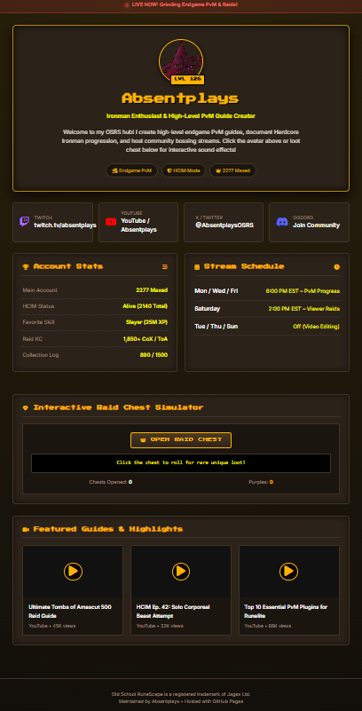

# ⚔️ Absentplays | OSRS Content Creator Portfolio & Link Hub

Welcome to the repository for **Absentplays**' official Old School RuneScape (OSRS) creator landing page, hosted with **GitHub Pages**.

This central hub highlights stream schedules, highscore stats, social links, latest video guides, and an interactive OSRS sound & loot drop engine.

---

## ✨ Features & What's New

* **Authentic OSRS Aesthetics**: Built using classic stone/gold interface aesthetics, retro pixel typography (`Press Start 2P`), and clean modern web standards.
* **Web Audio API Sound Engine**: Synthesized in-game sound effects (Level-Up fanfare, chest opening, item drops, and button clicks) with zero external audio assets needed.
* **Interactive Raid Loot Simulator**: A clickable RNG collection log simulator (featuring rare purple drops like *Tumeken's Shadow* and *Twisted Bow*) with dynamic drop counters and chat box broadcasts.
* **Live Stream Banner**: Dynamic top alert banner displaying live Twitch stream status.
* **Featured Guides & Highlights**: Video showcase section linking directly to YouTube guides and progress series.
* **Clean Project Structure**: Organized into separate custom stylesheets (`css/style.css`) and modular code for easy maintenance.

---

## 🚀 Quick Setup & Deployment

1. **Fork or Clone this repository** to your GitHub account.
2. **Customize `index.html`** with your details (social handles, stream times, and stats).
3. **Enable GitHub Pages**:
   - Navigate to **Settings** > **Pages** inside your repository settings.
   - Under **Build and deployment**, set the **Source** to `Deploy from a branch`.
   - Select the `main` (or `master`) branch and save.
4. Your page will be live at:  
   `https://<your-username>.github.io/<repository-name>/`

---

## 🛠️ Customization Guide

### 1. Basic Profile Info & Branding
Locate the `<header>` section inside `index.html` to update the creator title, subtitle, and biography:

```html
<h1 class="creator-title">Absentplays</h1>
<p class="subtitle">Ironman Enthusiast & High-Level PvM Guide Creator</p>
```

### 2. Customizing Social Links
Update the `href` attributes in the `.socials-grid` section:

```html
<a href="https://twitch.tv/absentplays" target="_blank" class="social-card twitch">
```

### 3. Modifying Audio Effects & Drop Rates
All interactive sound synthesizers and drop table probabilities are defined at the bottom of `index.html` within the `<script>` tag:
* Adjust `openRaidChest()` to change item drop chances or add new rewards.
* Tweak oscillator frequencies in `playTone()` to customize sound effects.

---

## 📸 Preview


---

## 📜 Disclaimer

*Old School RuneScape is a registered trademark of Jagex Ltd. This landing page is an unofficial fan project and is not affiliated with or endorsed by Jagex.*