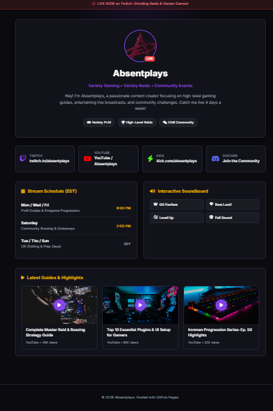

# 🎮 Streamer & Content Creator GitHub Pages Hub

Welcome to the repository for **Absentplays**' official streamer portfolio and link hub, built for deployment via **GitHub Pages**.

This landing page serves as a central showcase for live streams, social handles, weekly streaming schedules, video guides, and an interactive Web Audio soundboard.

---

## ✨ Features & Highlights

- **Live Stream Banner Indicator**: Highlight active stream status right at the top of your landing page.
- **Interactive Audio Engine**: Web Audio API soundboard generating retro sound effects (*GG Fanfare*, *Rare Loot*, *Level Up*) without external audio files.
- **Social Media Hub**: Instant links and handle copying for Twitch, YouTube, Kick, Discord, and Twitter/X.
- **Weekly Schedule Section**: Clean display for stream times and game schedules.
- **Featured Video Showcase**: Grid displaying video thumbnails, titles, and view counts.
- **Separated Clean Stylesheet**: All styles reside inside `css/style.css` for simple maintenance.

---

## What it looks like

---

## License
This project is open source and available under the MIT License.